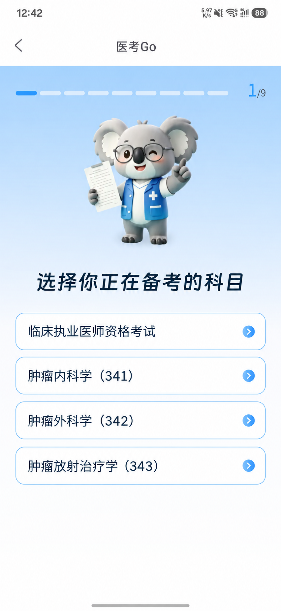

# 医考Go 肿瘤中级职称产品需求文档

医考Go 肿瘤中级职称产品需求文档

V0.3  评审稿  2026年9月22日

## 一 产品定位与目标

在现有医考Go小程序中接入肿瘤内科学（341）、肿瘤外科学（342）、肿瘤放射治疗学（343）备考内容，三个专业首期同时上线。以已有考试题目为主线，沿用测评、学习计划、闯关、解析和AI追问能力，在相关解析中融入指南／TNM依据并关联大查房病例。

| 项目 | 本期要求 |
| --- | --- |
| 核心目标 | 验证付费，主要观察付费人数与销售额；目标值及统计周期待定。 |
| 用户与载体 | 面向三个专业的备考用户，主要在医考Go小程序完成学习与购买。 |
| 内容基础 | 三个专业的相应题目已有；可上线题目清单、解析及关联资料由内容侧核对。 |
| 购买方式 | 一次购买解锁所选专业，不设到期时间，跨年度使用，内容免费更新，无需续费。 |
| 实现范围 | 适配现有能力；不新增独立指南／TNM入口、独立病例训练模块或额外四科勾选步骤。 |

## 二 用户场景

开始备考：选择所报考专业，完成对应测评，查看学习计划，进入闯关学习。

先体验再购买：免费完成测评、查看计划并体验部分闯关题目，购买后继续学习所选专业的后续内容。

理解题目：查看解析中的方案依据或分期条件；需要进一步理解时，进入题目关联的大查房病例，或使用已有AI追问。

## 三 核心流程

进入现有测评 → 选择考试专业 → 沿用备考信息填写与对应测评 → 免费查看学习计划 → 进入闯关并体验部分题目 → 购买所选专业 → 解锁后续内容。

学习延伸：答题 → 查看解析 → 阅读相关指南／TNM说明 → 按需进入关联的大查房病例。大查房打开位置待定，不影响其已包含在所购专业权益中的规则。

## 四 页面需求及示意

### 4.1 选择考试专业

保留现有首屏标题、考拉形象及1/9进度，在“临床执业医师资格考试”下方依次增加三个专业选项。点击选项后沿现有流程继续，后续测评、计划及题目与所选专业对应，不新增确认按钮或考试内部四科的勾选步骤。

选项文案：临床执业医师资格考试；肿瘤内科学（341）；肿瘤外科学（342）；肿瘤放射治疗学（343）。

临床执业医师入口沿用原流程。三个新增专业分别匹配对应内容，不将临床执医的测评题、题量宣传或学习结果直接复制过去。

### 4.2 测评与学习计划

复用现有备考信息填写、测评和计划页面。测评及学习计划免费；专业名称、测评题和计划中的学习内容须与首屏选择一致。测评题量、选题、评分及计划匹配按现有机制适配，具体配置在评审时核对。

学习计划继续引导进入现有闯关首页。不新增按已通过科目筛选的前置步骤；考试内部四科作为内容组织依据，具体章节与关卡映射由现有题库和学习结构确定。

### 4.3 闯关与题目解析

沿用已有闯关、答题、解析、错题及AI追问能力，加载所选专业内容。免费用户可体验部分闯关题目，超出体验范围时进入所选专业购买流程；已购买用户可继续使用该专业后续内容。

相关题目解析补充指南／TNM内容，说明为什么选择该方案、哪些条件影响分期。沿用现有解析结构，不额外设置独立学习入口；无相关内容的题目不强行添加。

指南或分期说明应对应所用版本，并写明来源。内容有分歧或来源尚未核实时，由内容侧完成核对后发布，不将未经审核的新生成文本直接作为正式依据。

AI追问沿用已有入口和能力。本期不把AI答疑作为新建模块；中级职称适用的免费次数、购买后额度及限制提示待核对，不直接采用考后估分方案中的每日5次或不限次规则。

### 4.4 关联大查房

题目存在有效关联病例时，在解析中提供病例标题及“查看相关病例”入口；没有关联内容时不显示空入口。关联以能帮助理解当前知识点为准，不要求每道题都配病例。

已购买用户可使用所购专业关联的大查房病例，无需再次付费；该权益不扩大为全部大查房内容。免费体验用户能否访问关联病例待定。

小程序内打开还是跳转肿瘤医生APP，暂不确定。评审时需补齐打开、登录、权益识别和返回原题的路径；无论采用哪种方式，进入病例前已保存的答题进度应保留。

### 4.5 购买与权益展示

复用现有购买页面，明确展示所购专业、价格及权益：“一次购买，长期有效，免费更新”，并说明包含该专业关联的大查房病例。价格待定，不沿用旧图的9.9元、30天等文案。

购买成功后解锁对应专业，返回用户原学习位置继续；取消或支付失败时保留原进度，不解锁后续付费内容。实际扣款但权益未显示时，应核查订单并恢复已购权益，不引导重复购买；现有处理能力在评审时核对。

## 五 权益与业务规则

| 能力 | 未购买所选专业 | 已购买所选专业 |
| --- | --- | --- |
| 测评与学习计划 | 免费使用 | 免费使用 |
| 闯关题目 | 可体验部分题目，范围待定 | 解锁所购专业后续内容 |
| 题目解析 | 体验题解析范围待定 | 提供所购专业题目解析及相关指南／TNM说明 |
| AI追问 | 复用已有能力，适用额度待定 | 复用已有能力，购买后额度待定 |
| 关联大查房病例 | 是否开放待定 | 包含在所购专业权益中，无需另付费 |
| 有效期与更新 | 不适用 | 不设到期时间，跨年度使用，内容免费更新 |
| 其他专业 | 不因体验当前专业而解锁 | 不随本次购买自动解锁 |

## 返回 续答与异常

以下作为适配验收要求，优先复用现有处理方式；若现有行为不同，在评审中确认调整。

| 场景 | 处理要求 |
| --- | --- |
| 内容加载失败 | 保留所选专业，提示重试，不用其他专业题目替代。 |
| 提交失败或重复点击 | 保留当前选择并允许重试；成功保存后再更新进度，不重复累计。 |
| 退出后再次进入 | 在同一账号、同一专业内恢复已保存进度；未保存的作答不显示为已完成。 |
| 返回首屏更换专业 | 进入新专业对应内容，已保存记录按专业保留，不将原专业测评结果或购买权益套用到新专业。 |
| 关联病例不可用 | 提示当前病例不可用，允许返回题目解析，不阻断继续学习。 |
| 需要登录 | 沿用现有登录入口；登录后回到发起操作的位置，取消后保留可免费访问的页面。 |

跨小程序与APP的账号、进度及权益互通未确认，本稿不承诺跨端自动续答。答题计分、返回及回看优先核对现有练习规则，不把模拟考试的特殊计分或不可回退说法直接加入本期。

## 六 关键验收

| 检查项 | 验收标准 |
| --- | --- |
| 专业入口 | 首屏四个选项名称、代码、顺序正确；无需额外四科勾选，点击后继续对应流程。 |
| 三专业适配 | 分别选341、342、343，测评、计划、关卡与题目均匹配所选专业；临床执医入口不受影响。 |
| 免费体验 | 未购买用户能完成测评、查看计划并进入规定体验题；超出范围进入对应专业购买流程。具体边界按待定项补齐后验收。 |
| 购买范围 | 购买341只解锁341，342、343不自动解锁；原专业已购用户不被再次要求购买同一权益。 |
| 长期使用 | 不因固定天数或跨考试年度而失效；所购专业内容更新不另收费。 |
| 解析与病例 | 相关题目可查看已审核的指南／TNM说明及关联病例入口；无关联不显示空入口。 |
| 大查房权益 | 所购专业关联病例可使用且不再次收费；不因此开放全部大查房。打开方式确定后补测完整往返路径。 |
| 进度与异常 | 切换专业不串记录；退出、提交失败、购买取消和病例不可用按第五节处理。 |

## 七 待定项与上线依赖

| 项目 | 需补齐内容 |
| --- | --- |
| 定价与体验 | 各专业价格、免费体验题量及选题方式、体验题解析和关联病例开放范围。 |
| AI权益 | 核对现有规则，确定中级职称免费用户与已购用户的追问额度及限制提示。 |
| 内容配置 | 确认三专业可上线题目清单、测评与关卡映射；核对解析、指南／TNM版本、病例关联、使用授权及审核更新责任。 |
| 跨端承接 | 确定大查房打开位置、账号与权益识别、返回路径；明确是否涉及APP进度互通。 |
| 业务指标 | 以付费人数、销售额为主要指标；统计周期、退款口径、去重方式及目标值待定，不新增已承诺的数据看板。 |

以上未定项不影响本轮评审已确认的产品方向；涉及收费边界、内容发布和跨端承接的规则，需在对应功能上线前补齐。
