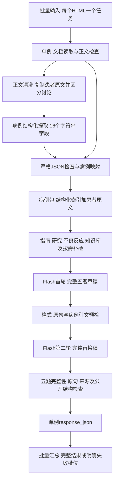

# HTML与完整五题联动整改

版本：20260929-html-five-contract。基于“完整工作流-Flash五题-20260929”继续修改，共调整14个节点的代码或提示词，三个工作流的节点数量和连线不变。上一套文件保留，可回退。本包尚未导入线上应用，也未执行新的线上AI生成。

## 本次导入哪些文件

| 文件 | 用途 | 本次处理 |
|---|---|---|
| 01-出题子应用.json | 检索、两轮出题、核对及最终输出 | 更新原有出题子应用 |
| 02-HTML单例外层.json | HTML读取、清洗、病例提取、调用出题 | 更新原有HTML单例应用 |
| 03-批量生成.json | 每文件调用单例应用并汇总 | 与上一套完全相同，已经使用上一套时无需重导 |

这次必须配套更新01和02。只更新出题提示词，不会把新增的患者原文传进来；只更新HTML侧，也不能消除出题输出协议的歧义。

优先导入原有对应应用，保留应用ID。如果新建应用，需要重新选择两处调用：02中的“题目生成”指向01；03中的“三连”指向02。“三连”只是沿用的旧节点名，实际每个文件只调用一次单例应用。

**01中的“知识库搜索”导出配置datasets为空，导入后必须选回原有知识库。** “研究线索提取”的quotes已引用该搜索的quoteQA输出，不再是截图中的空引用；知识库、指南、原始研究与按需补检链保留。导出JSON无法证明线上知识库、应用及外部检索服务已正确绑定。

## 完整运行链路

出题子应用33节点/52连线；单例外层11节点/11连线；批量8节点/7连线。

两轮核心出题均为qwen3.8-flash，温度统一0.1，配置输出上限16000。HTML清洗、病例提取也沿用Flash，温度0；没有增加AI调用。原有按需irAE锚点回退模型仍为qwen3.5-plus-nothinking，没有在本轮更换。批量并发10、重试0保持原配置。

## 为什么之前越改越容易失败

这里有多个不同问题，不能统一归因于知识库或模型：

1. 整套JSON示例声明5题，却只展示一个题目对象；修订要求又容易被理解成只返回改动题。真实结果同时出现漏写、根级Q2–Q5错位、两个questions键。这是协议歧义，不能证明所有漏写均由提示词导致。
2. HTML清洗、结构化摘要、逐字证据核对没有对齐。出题只看提取后的索引，关键的疑似、限制及原句形态可能丢失；后面的严格匹配又把中文断行、公式转义差异当作失败。
3. 旧JSON修复试图猜测引号和修改日期，可能改变病例文本。现在只处理明确格式，不猜医学内容。
4. 原句检查通过只能证明引文存在，不能证明一般MDT原则或检查清单支持某个具体治疗。之前增加检查的同时，对其保证范围说明不足。
5. 上一轮外层返回过多重复别名已精简，本轮继续保留。但“Invalid worker response”的线上根因未得到日志确认，本包不能保证消除该平台报错。

## 已落实的修改

### HTML直接适配出题

- 原始HTML文本分支清理脚本、样式、注释和标签，解码实体，保留段落及表格行列分隔；已经由文档读取器转成纯文本的内容不再按HTML重写。
- 清洗侧只复制患者原文段落，另列导语、讨论、专家观点和参考资料。不能把建议改成患者已发生事件，不能从图片推断数值。
- 提取仍为16个字符串字段，随后映射为原来的病例字段；新增内部可选case_source_text，携带清洗后且能回溯文档原句的患者正文。公开题目结构不变。
- 每段病例正文做原句回溯。clean状态但正文改写时明确报CASE_SOURCE_REWRITE；原文缺失报CASE_SOURCE_EMPTY；清洗状态未通过报CASE_SOURCE_REVIEW_REQUIRED。通过只代表原句可追溯，不能验证清洗分类与医学含义是否正确，也不保证无遗漏。
- 病例ID改由文档正文生成，避免同一次输入仅因模型改写标题而变化。与历史标题生成的ID可能不同；不是跨格式、跨版本去重ID，正文变化或文本读取方式变化仍可能改变ID，不自动迁移旧记录。
- JSON格式修复保留围栏去除及字符串内实际换行/制表符的转义；不再猜缺失引号、改写日期或吞掉重复键。

### 五题协议及原句核对

- 去掉误导性的一题整套示例。明确首轮输出完整草稿，第二轮输出包含原有合格题的完整替换稿；Q1–Q5只能在唯一questions数组内。
- 对已经存在的五个完整且唯一的Q1–Q5对象，允许将根级题目原样归入数组，并记录QUESTION_LAYOUT_REPAIRED。随后继续全量检查每题，不能绕过引文或病例核对。
- 真正缺四题、题号冲突、重复questions或嵌套重复答案键仍拒绝。不会复制题、编造答案或修改计数凑五题。
- 保守兼容中文字符之间的排版断行、部分内联标签、百分号及范围的公式转义；保留英文词边界、表格边界、否定、小数、不等号。保留原文位置与匹配方式，不用模糊相似度替代原句核对。
- 首轮系统提示词从4436字符压缩至2581字符。集中要求核对“证据是否支持正确项全部措施”“病例是否满足阈值”“最接近备选为什么不适用”，并说明未知条件、责任药、时点与疑似/确诊的边界。
- 保持自然的“下列哪项正确”、四个选项、公开A/B/C/D四行解析；不打乱已有合格选项。最多两题显式延伸情境，完整成功仍必须五题。

## 验证结果与范围

34项离线回归全部通过，详见回归检查.json。包括全部代码语法、节点变量引用、保留检索链、五题公开结构、错误引文/病例事实/重复键拦截、空及多文件异常、提取格式、单例与批量结果传递。

使用最新9份实际返回结果定位问题，其中6份带有失败时的第二轮原稿，可重放结构解析：

| 最新附件顺序 | 原问题 | 新程序离线结果 |
|---|---|---|
| 1 | 两个questions键 | 仍拒绝，不静默覆盖 |
| 2 | 真正只有Q1，计数虚报5 | 不补造，仍需模型生成其余题 |
| 5 | 五题已有，引文及病例事实有失败 | 五题结构保留，临床及完整来源校验不能据附件全部重放 |
| 6、7 | Q2–Q5在根对象 | 原样归入数组，恢复五题供后续核对 |
| 9 | 五题已有，公式排版不匹配 | 结构保留，新增显示格式兼容 |

这不是新模型的9例成功率，也不能据此宣布第6、7例已经完成医学复核。附件未包含全部上游病例包和未引用证据池。

另外读取本地10个真实HTML（136519、137992、139431、143320、144506、151422、151454、153018、162144、163395），验证正文处理和选定原句传递。清洗/提取模型使用确定性原句测试输入，并未重新调用AI；没有验证FastGPT线上文件读取器、模型清洗完整性、外部检索或最终题目质量。PDF未做本轮文件回归。

## 导入后的首轮验收

1. 更新01与02并选回知识库；确认02调用01、03调用02。
2. 先选一份原来失败的HTML走单例完整链路，查看“代码运行”的case_payload_json是否包含case_source_text、原有病例字段及稳定case_id。
3. 完整结果应为五题、四个不同选项、正确答案索引对应文本、四行解析；失败结果必须有具体节点或execution_report诊断，不能只看response_json非空。
4. 单例确认后再跑一批。既要检查每例题数和失败槽位，也要看病例事实、临床适用条件与证据是否支持题目全部主张。

publishable=false及medical_review_status=not_performed保持。任何程序PASS或OUTPUT_READY均不代表已做独立医学审核。
