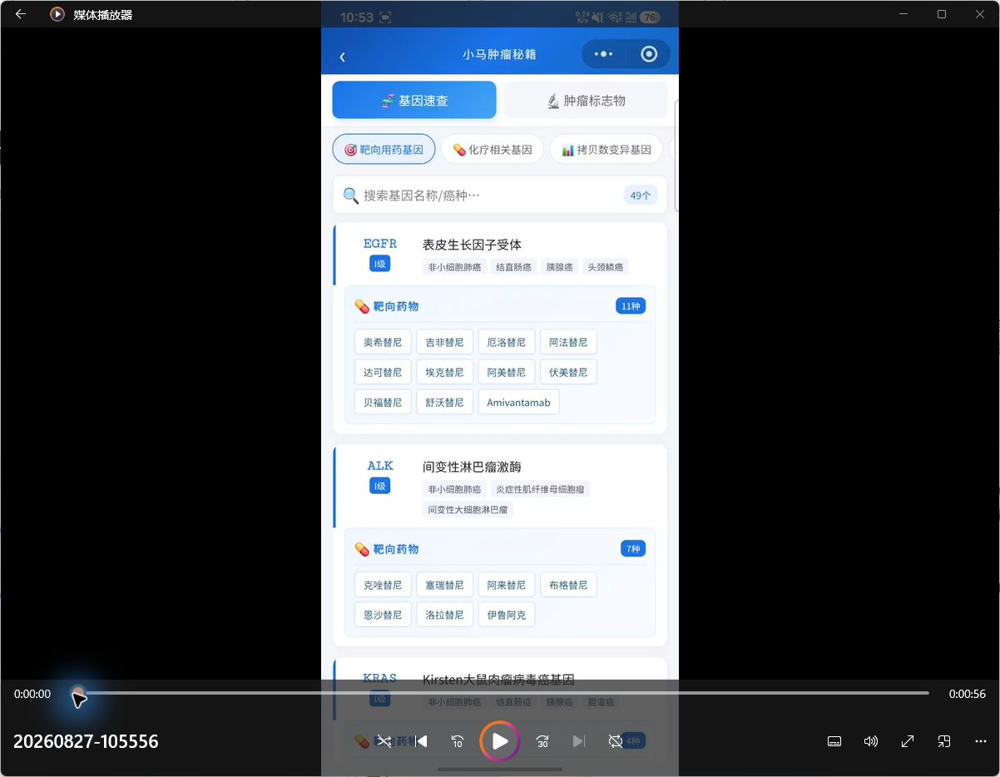
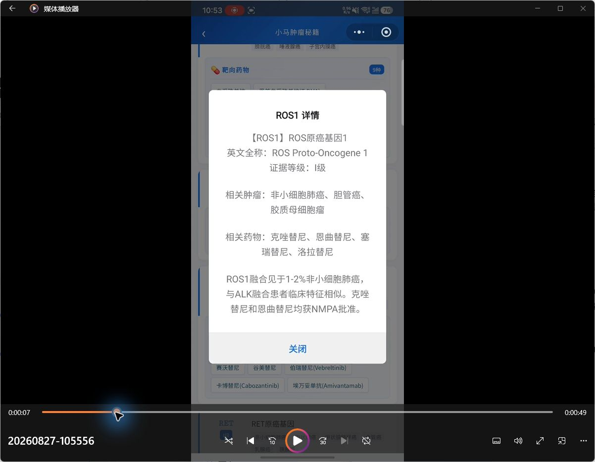
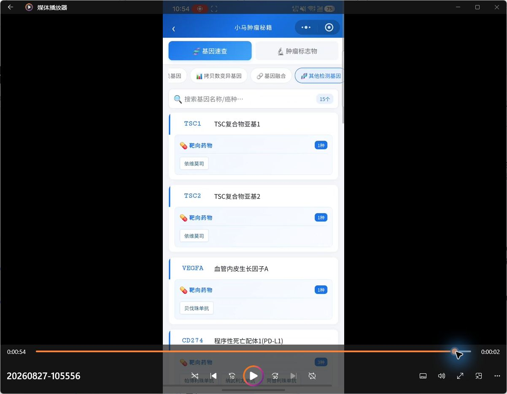

# 参考视频借鉴与差异化方案

## 结论

视频展示的是一个面向移动端的“肿瘤基因/标志物速查”产品：医生通过顶部分类、标签筛选和搜索定位基因，在卡片中浏览相关瘤种、药物数量和药物名称，点击后以弹窗查看简要解释。

这个方向适合借鉴，但不建议做成单纯的基因百科。结合现有 FastGPT 工作流和知识库，更适合定位为：

**肿瘤生物标志物与用药证据速查**

核心价值不是“列出基因和药物”，而是回答医生真正需要核对的四件事：这个变异在该瘤种中意味着什么、有哪些获批或指南支持的药物、证据适用条件是什么、来源与更新时间在哪里。

## 视频流程拆解

### 1. 分类、搜索与卡片浏览

健康度：良好。入口直观，分类、搜索和结果数量都在首屏；卡片能快速扫读。但关系被简化成“基因—药物”，缺少具体变异、瘤种情境、治疗线次、批准地区、证据来源和更新时间。

### 2. 点击查看基因详情

健康度：一般。弹窗适合快速查看，但“证据等级”未显示分级标准，也没有原始来源定位，医生无法判断等级由谁定义、何时更新、适用于哪个变异和瘤种。

### 3. 切换不同基因类别

健康度：良好。横向分类便于快速缩小范围；但标签较多、文字较小，移动端可能出现发现性、点击目标和横向滚动问题。

## 值得借鉴的部分

- 采用“先筛选，后阅读”的工具型入口，不强迫医生先和聊天机器人对话。
- 搜索、分类、结果数量和卡片列表组成清晰的单任务页面。
- 卡片仅放高频信息，详情通过抽屉或弹窗展开。
- 基因、瘤种和药物均可作为检索入口。
- 适合微信小程序或医生端移动页面，使用成本低。

## 必须做出差异的部分

- 不复制名称、配色、图标、卡片样式、分类文案、介绍文字和视频素材。
- 不把“相关药物”直接写成治疗推荐；必须附带瘤种、变异、线次、批准地区与证据条件。
- 不使用没有分级说明的“Ⅰ级/Ⅱ级”；显示证据体系名称、版本和判定规则。
- 每条结论必须显示来源类型、标题、版本/年份、页码或段落定位、知识库更新时间。
- 指南、药品说明书、临床研究和会议摘要必须分层展示，不能混成同一强度。
- 对冲突、超说明书、阴性证据和资料不足状态明确标记。

## 推荐的医生端信息结构

### 查询区

- 瘤种（可选）
- 分期/治疗阶段（可选）
- 基因或具体变异（至少一项）
- 药物（可选）
- 场景：快速速查 / 分子报告核对 / 用药依据核对

### 结果卡片

- 标准基因名与具体变异
- 变异类型及检测样本/方法提示
- 适用瘤种和临床情境
- 中国药品说明书状态
- 指南推荐及推荐等级
- 相关药物及适用条件
- 耐药或不支持信息
- 最新研究（与正式依据分栏）
- 证据来源、版本、发布日期、定位和更新时间
- 冲突/缺失提示

## 与现有知识库的对应

- 正式依据：`临床指南-产线数据`、`问指南专用`、`ASCO 202505`。
- 药品核对：`药品说明书`、`用药助手`、`2022药品信息`、`药品词表`、`药品中英文对照`。
- 临床验证：`军见病-临床验证数据库-20250725`。
- 研究更新：`AACR 2025`、`ELCC 2025知识库`、`期刊与国际会议From凌超`、顶刊/大会文章库。
- 仅作背景补充：疾病百科和自动更新文章库。
- 不作为正式证据：测试题库、考试题库、已淘汰医生文章库、即将下线化疗测试、专家履历或观点库。

## FastGPT 最小可行工作流

1. 流程开始：接收瘤种、分期、基因/变异、药物和查询场景。
2. 术语标准化：统一基因别名、药物中英文名、瘤种名称和变异写法。
3. 问题分类：判断走“基因速查”“说明书核对”还是“报告完整性核对”。
4. 并行检索：指南、药品说明书、临床验证、研究更新四路检索。
5. 证据合并：去重，按正式依据/研究更新分层，保留来源定位。
6. 冲突检查：发现适用瘤种、变异、线次、批准地区或版本不一致时标红，不自行裁决。
7. 结果生成：输出固定 JSON，由前端渲染成卡片和详情抽屉。
8. 独立校验：检查每个医学结论是否存在来源，缺证据则删除或标记“未检索到可靠依据”。

建议第一版只做肺癌的 10—15 个高频驱动基因与常用药物，把来源、适用条件和冲突提示做扎实，再扩展全瘤种。

## 可见的体验风险

- 浅灰小字和细边框可能存在对比度风险。
- 横向标签较多，用户可能不知道还能继续滑动。
- 药物标签密集，点击目标可能偏小。
- 弹窗内容较长但层级单一，适用条件和证据来源不够突出。
- 仅凭视频无法确认键盘操作、屏幕阅读器语义、焦点管理、缩放和横竖屏适配情况，因此不能判断完整无障碍合规性。

## 建议的下一步

先在 FastGPT 中做一个独立小工具原型：输入“肺癌 + BRAF V600E”，返回说明书、指南、研究更新三层证据卡，并带来源定位。验证结构和证据质量后，再接微信小程序或医生端前端。
