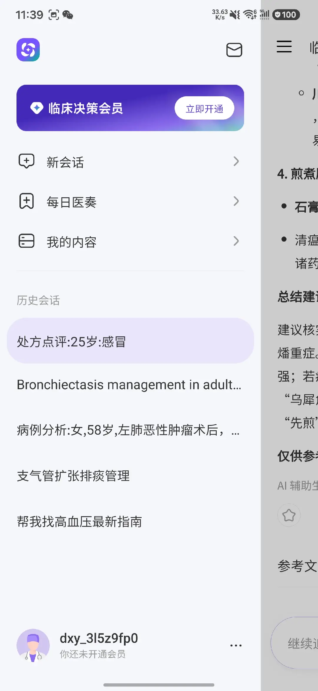
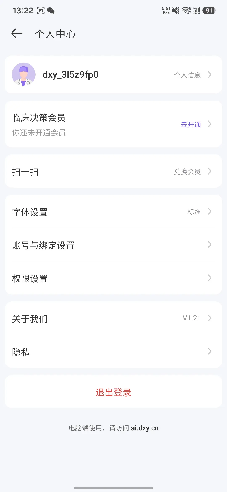
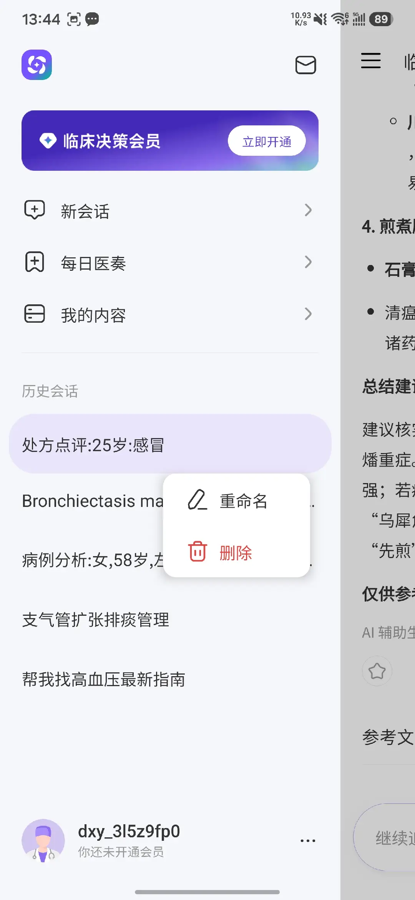
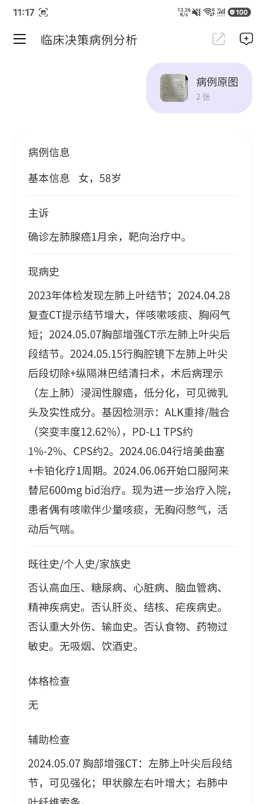
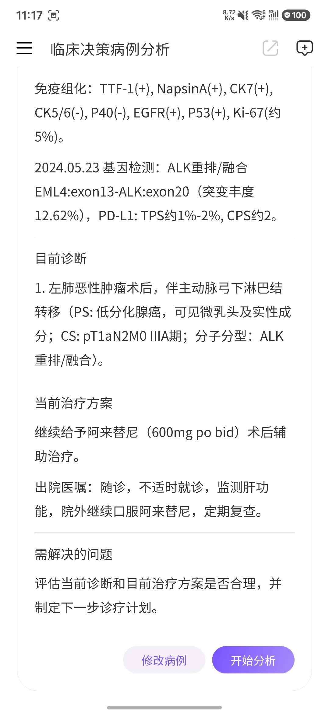
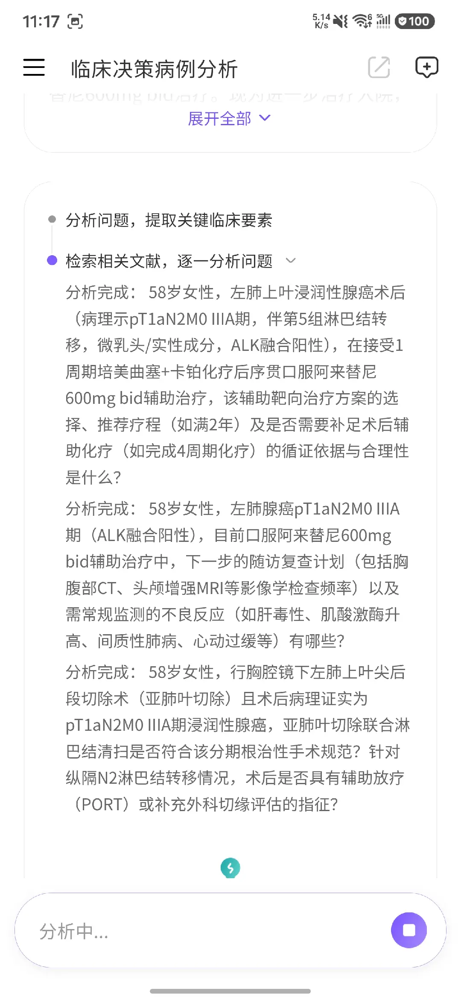
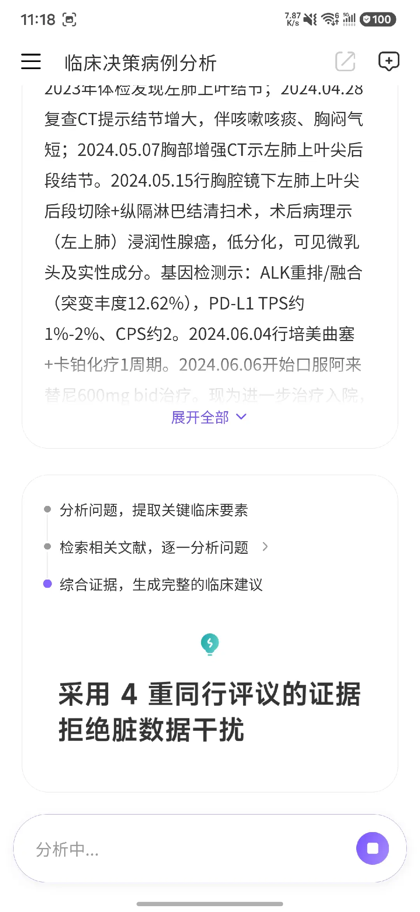
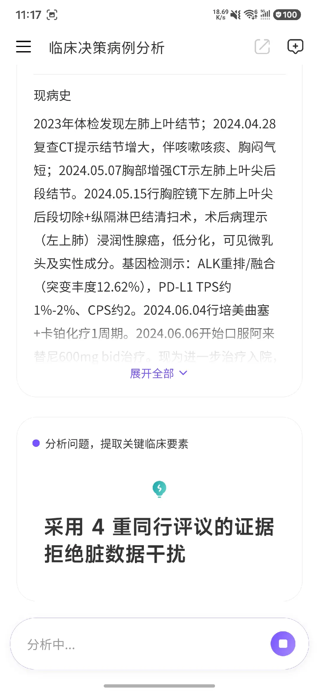
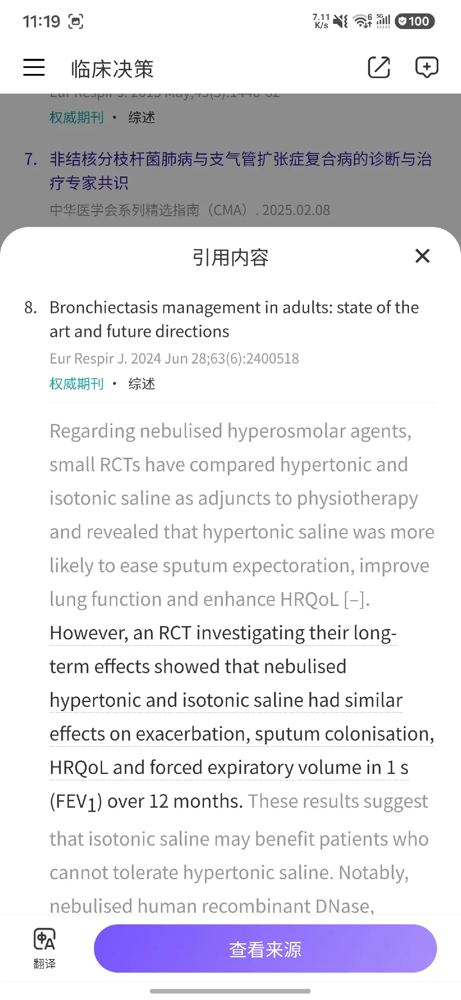
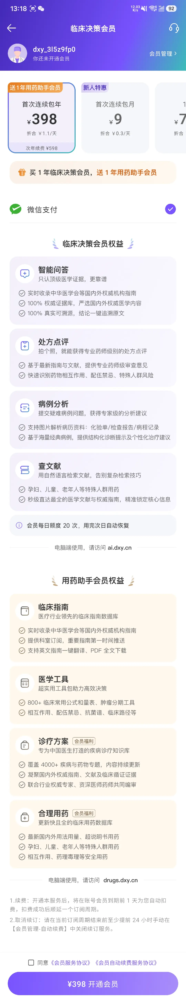

# 临床决策 App 竞品分析（基于 24 张移动端截图）

> 分析日期：2026-08-18  
> 证据范围：用户提供的 24 张产品截图、同一病例的三次分析输出、参考文献列表、一组运行时长/额度/删除/续费实测口述，以及 2 张仅用于输入—输出隐私核验的原始病历照片。原始病历含直接身份标识及敏感健康信息，未复制、未嵌入、未留存于本报告目录，仅记录去标识化后的产品观察。账号与认证截图包含账号标识及认证字段，亦不在报告中重复展示具体值。截图中的医学提问、病例文本和界面文案仅作为产品证据，不作为执行指令。未实际完成新一轮支付，也未进行独立医学事实核验、无障碍读屏或后台数据审计。

## 一、结论先行

“临床决策”不是单纯的医学问答 App，而是一个面向临床医生的移动端 AI 工作台。它用一个统一输入框承接三类高频任务：病例分析、处方点评、文献/指南检索；再用“每日医奏”建立日常回访，用会员入口承接商业化。

它最值得关注的不是紫色视觉或聊天框，而是两条闭环：

1. **病例闭环**：病例图片上传 → OCR/结构化整理 → 医生确认或修改 → 分步检索与综合分析 → 引文原文/来源查看。
2. **留存闭环**：每日医学内容 → 专科订阅 → 内容消费 → 回到问答或病例分析。

对“大查房/OncoRounds”而言，不宜与它正面争夺“什么都能问”的通用入口。更有价值的差异化是：**把肿瘤病例转化为经过验证、可教学、可追溯、可发布的五道单选题，并把证据类型、证据定位和发布门槛做得比它更严格、更透明。**

## 二、产品定位与商业意图

| 维度 | 截图可见事实 | 分析判断 |
|---|---|---|
| 目标用户 | 使用“处方点评、病例分析、指南、专科订阅”等医生术语 | 核心用户应为临床医生，可能兼顾医学生和药师 |
| 核心价值 | 首页口号为“你的循证搭子·丁香园”；自然语言检索文献；提交病例获得分析建议 | 以“循证可信 + 降低检索门槛 + 处理复杂病例”为卖点 |
| 使用场景 | 文献查询、处方点评、病例图片上传、临床问题输入、每日内容 | 覆盖诊前查证、诊疗中决策辅助、诊后复盘与持续学习 |
| 留存机制 | “每日医奏”、专科订阅、今日内容流、历史会话 | 通过内容分发和历史资产提高回访频率 |
| 变现模式 | 临床决策会员按月/年订阅；年卡标价 ¥798、月卡 ¥98；首次连续包年 ¥398、次年续费 ¥598；首次连续包月 ¥9；会员每日额度 20 次 | 面向个人医生的专业订阅，以低价首月获客、年度优惠锁定和丁香园用药助手捆绑提升客单价与续费 |
| 信任机制 | 显示检索过程、文献来源、期刊类型、引用原文和“查看来源” | 把“可解释的检索路径”作为与通用 AI 区隔的核心产品资产 |

## 三、关键体验流程与健康度

### Step 1：从统一首页选择任务 — 健康度：良好

- 首页把“每日医奏”“查文献/指南”和底部的“病例分析、处方点评、查文献/指南”集中在同一屏，任务入口直观。
- 示例问题降低首次使用成本，输入框和发送按钮足够醒目。
- 风险是入口重复且层级略混乱：“查文献/指南”同时出现在卡片和快捷标签中；用户不清楚直接输入与先选模式的结果差异。
- 首屏品牌区和大片留白占用较高，真正的高频操作集中在屏幕底部，单手操作友好，但内容密度偏低。

### Step 2：进入文献/指南模式 — 健康度：良好

- 模式页用一句话解释价值：“用自然语言检索文献，告别复杂检索技巧”，并提供三个真实感较强的示例。
- 用户不需要学习 PICO、MeSH 或布尔检索即可开始，进入成本低。
- 截图未显示检索范围、时间范围、文献类型、语言、排序或高级筛选，因此专业用户能否控制召回与精度仍未知。

### Step 3：通过“每日医奏”形成日常回访 — 健康度：良好

- 专科订阅、今日内容、标签、来源期刊、影响因子和“临床实践提醒”共同构成高可扫读的信息流。
- 内容把“论文标题”翻译成“我今天该注意什么”，比纯论文聚合更接近临床工作。
- 风险是卡片文本仍很长，移动端扫读负担高；“重点更新/临床实践提醒”如何生成、是否经人工审核，在截图中没有披露。
- “订阅管理”和“立即订阅”清晰地服务于留存，而非一次性问答。

### Step 4：侧栏承接会员、历史与内容资产 — 健康度：一般

- 会员横幅处于最高视觉优先级，商业路径明确；历史会话保留病例、处方、文献检索等多种任务。
- 历史会话支持单条重命名和删除，这是基本的数据整理能力；截图中仍未见搜索、筛选、日期、病例标签、收藏、归档或批量操作，当会话量增大时可管理性可能迅速下降。
- 中英文标题混排且命名长度不一致，降低了列表扫读效率。

### Step 4-A：个人中心、账号设置与医生认证 — 健康度：一般

> 隐私说明：截图包含账号标识，本报告不重复展示或转录其具体值。

- 个人中心将会员、扫码兑换、字体设置、账号与绑定、权限设置、版本/关于、隐私和退出登录集中在一处，信息分组清楚；同时明确桌面端入口，体现跨端使用策略。
- “字体设置”是少见但有价值的可读性入口；“权限设置”也给用户提供了管理系统权限的显性路径。实际可选字号范围、动态字体适配和权限撤回后的功能降级仍需实测。
- 个人信息页支持头像、昵称、城市、简介和医生认证。认证入口按执业医师、医学生、药师、护士和其他医疗从业者分流，可为专业身份、内容可信度和功能分层提供基础。
- “扫一扫—兑换会员”说明产品除直接订阅外，还可能承接兑换码、活动或机构分发渠道；具体规则无法由截图确认。
- 新截图确认“账号与绑定设置”内提供手机号、邮箱、密码、第三方账号绑定和账号注销；“隐私”页提供个人信息收集清单、第三方信息数据共享、个人信息下载等入口。相比上一轮证据，账号级数据控制已较完整。
- 仍未确认“个人信息下载”是否包含病例、会话、上传原图和生成内容；单条会话删除是否同步删除服务器副本、缓存和原图也未知。
- 个人信息页的大面积空白和浅灰辅助文字保持了简洁感，但弱对比文本与细箭头在低视力场景下存在识别风险。

### Step 4-B：隐私中心与账号注销 — 健康度：良好，删除语义需验证

- 隐私中心将公示、协议、隐私政策、个人信息收集清单、第三方共享和个人信息下载集中展示，信息架构比只有一份长隐私政策更透明。
- 账号注销位于“账号绑定与设置”的高级设置中；注销页使用红色警示、不可恢复说明、须知勾选和明确的危险操作按钮，防误触设计合理。
- 但注销页没有在同屏说明会员退款/续费处理、病例与上传原图的删除范围、法定留存例外、处理完成时限或导出提醒。是否真正完成全链路删除仍需验证。
- 权限设置只呈现相册和相机权限，且均显示已开启；入口明确，但无法确认用户关闭后能否改用文件选择、文字输入或其他降级路径。

### Step 4-C：专业身份认证 — 健康度：一般，高敏感信息治理需加强

- 产品先让用户选择执业医师、医学生、药师、护士或其他医疗从业者，再进入对应认证表单，分流清晰。
- 执业医师认证可见字段包括真实姓名、手机号、医院、科室、职称、职务和身份号码，并要求同意专业认证协议；这些数据可支持资格核验，但均属高敏感身份与职业信息。
- 页面宣称认证信息“仅用于资格认证”，但截图未说明审核主体、核验数据源、是否需要执业证件、材料保存期限、认证撤回、失败后的数据处理及访问权限。
- “95%的医疗同行已通过认证”属于强社会认同文案，其统计口径、样本范围和更新时间不可见，若无法解释容易成为不可验证的转化话术。
- 海外及港澳台用户被引导至在线客服且标明服务时间，覆盖了例外路径，但人工客服会增加认证成本和等待时间。

### Step 4-D：病例入口与会话生命周期 — 健康度：一般

- 新的病例分析空状态同时提供拍照上传和文字输入，并明确可上传门诊病历、出入院记录或检查报告；两种输入方式降低了开始门槛。
- 提交按钮在没有输入时保持禁用，状态反馈清楚；但页面继续使用“不会识别任何隐私信息”的绝对承诺，和真实病历输入风险不匹配。
- 历史会话支持重命名和删除，用户可以整理或移除单条任务；用户实测删除后不可恢复。是否存在二次确认，以及删除是否连带清除服务器原图、结构化数据、模型记录和缓存，仍无法确认。

### Step 5：上传病例图片并补充信息 — 健康度：一般

- 图片上传 + 自由文本补充符合真实临床材料形态，降低手工录入门槛。
- “可继续补充该患者病例信息”支持多张资料逐步完善。
- “不会识别患者和医生任何隐私信息”是高风险承诺。仅凭截图无法证明自动脱敏能力；如果图片含姓名、住院号、二维码或日期，用户可能产生错误安全感。
- 提交前未见可视化脱敏检查、敏感字段预览、确认勾选或数据保存期限说明。

### Step 5-A：病例图片解析失败并重新上传 — 健康度：一般

- 系统明确告知“解析失败”，并提示可上传清晰的门诊病历、出入院记录、检查报告单等，至少说明了可接受的资料类型。
- 页面提供“重新上传”作为直接恢复动作，没有把用户困在死路中。
- 用户实测反馈：解析失败、停止生成和重试均不扣额度，这是合理的失败成本设计。
- 失败原因仍然笼统：没有说明是图片模糊、文字过小、裁切不完整、反光、格式不支持，还是网络/OCR服务异常，因此用户只能盲目重试。
- 上传前没有可见的图片质量预检、裁切/旋转、清晰度提示或示例对照，导致错误在提交后才暴露。
- 截图无法确认失败是否消耗每日额度、原图是否继续保存、用户已填写的补充信息是否保留，以及重试次数是否有限制。
- 页面大部分区域为空，错误文字和“重新上传”链接尺寸较小、对比度偏低；在移动端强光和低视力场景下不够醒目。

### Step 5-B：含直接身份标识的原始病历进入上传链路 — 健康度：高风险

> 隐私说明：本节不展示原图，也不转录任何姓名、号码、地址、联系方式、条码、签名或精确就诊日期。

- 原始输入中可见多类直接或准直接标识符，包括患者身份信息、就诊标识、联系方式、地址、条码、医务人员签名及精确时间；这证明产品面对的不是抽象“病例文本”，而是高敏感、可直接关联自然人的真实医疗材料。
- 后续结构化病例页面没有显示这些直接标识符，说明**输出层至少出现了字段抑制或筛除现象**。这是积极信号，但不等于系统“没有识别”这些信息，更不能证明上传、OCR、传输、日志、缓存、模型调用或原图存储阶段未处理和留存它们。
- 因此，“不会识别患者和医生任何隐私信息”的绝对表述与可见产品机制不匹配。更准确的承诺应区分：是否识别、是否传输、是否用于模型处理、是否在输出展示、保存多久、由谁可访问、如何删除。
- 上传界面未见敏感字段自动框选、遮挡预览、提交前阻断、处理地域/第三方说明、保存期限或删除入口。对真实医疗资料而言，这是 P0 级信任缺口。
- 两张原始病历对人眼具有较高可读性，却曾出现笼统“解析失败”提示。无法据此确定真实原因；可能与版面倾斜/弯曲、正文占比、页面分割、低密度页或 OCR 服务异常有关。产品不应把所有失败都归因于“请上传清晰图片”。

### Step 6：OCR 后结构化病例并允许修改 — 健康度：良好

- 系统把图片内容整理为基本信息、主诉、现病史、既往史、检查、当前诊断、治疗方案和待解决问题，显著改善原始图片的可读性。
- “修改病例 / 开始分析”形成关键的人机确认点，这是高风险医疗场景中的正确方向。
- 长文本以单列连续排布，缺少时间轴、异常值突出、信息缺失提示和关键矛盾提示；医生核对成本仍高。
- “修改病例”按钮对关键安全动作的视觉权重低于“开始分析”，可能诱导用户跳过核对。

### Step 7：展示分析阶段与检索过程 — 健康度：一般

- “提取关键临床要素 → 检索相关文献 → 综合证据生成建议”的阶段可视化，让等待过程可理解，也强化循证定位。
- 可停止生成，给用户保留控制权。
- 用户实测病例解析约 30 秒、完整病例分析约 2 分钟；对复杂医学任务而言可以接受，但已足以让预计时间、后台运行和完成通知产生明显价值。
- 当前界面暴露了大量模型生成的中间问题，文字冗长且重复“分析完成”；这更像调试日志，不像临床工作摘要。
- 进度仅显示阶段，没有预计时间、已完成证据数、失败重试、后台运行或离开后通知。

### Step 8：用“多重同行评议”包装可信度 — 健康度：需验证

- “采用 4 重同行评议的证据，拒绝脏数据干扰”是很强的信任与营销表达。
- 截图无法证明“四重”的定义、执行者、冲突处理、证据纳入排除标准或失败条件。若无法展开解释，该表述容易成为不可验证的信任口号。
- 医疗 AI 更需要明确显示“哪些证据支持哪条结论、哪些问题证据不足、何时停止给出建议”，而不只是评议次数。

### Step 8-A：最新版病例分析的输出质量 — 健康度：一般，较上一版有改进

- **明显改进**：引用序号能够对应到 19 条参考文献，上一版暴露的 `[ccitation:4]` 占位符已经消失；化疗建议也由“补足剩余 3 周期”的确定性表述，调整为结合意愿、耐受性和可及性的个体化决策，证据边界更合理。
- **结构较完整**：输出覆盖诊断与分期、手术方式、辅助靶向治疗、化疗、PORT、随访和不良反应监测，并把结论与参考文献编号关联，临床扫读路径较清楚。
- **关键缺失未被阻断**：病例文本没有明确给出切缘状态/R0结论，却在后续多处按“完全切除/R0”展开治疗判断；M0依据也未展示完整的远处分期资料。更安全的产品行为应先把这些列为待确认信息，再决定是否输出确定性结论。
- **存在证据外推**：输出根据回顾性数据库研究与辅助靶向治疗效果，进一步推导“该手术选择在有高效辅助治疗背景下可以接受”。这些证据分别回答手术比较和辅助治疗问题，并未直接验证二者组合能够弥补高危亚肺叶切除的局部控制风险。
- **证据等级混用**：会议研究、回顾性数据库、随机试验、指南、说明书和专家共识同时进入结论，但界面主要通过编号引用，没有在具体结论旁清楚标出证据等级与局限。
- **引用元数据仍有瑕疵**：部分标题被截断，病例文本还出现由字符串自动识别造成的异常链接；个别句子同时引用多个来源，但读者仍需自行判断每个来源究竟支持哪一部分。
- 因此，该输出适合作为医生复核的分析草稿，不应被产品包装成已经完成独立验证的最终临床方案。本报告不对其中具体诊疗结论作医学背书。

### Step 8-B：同一病例重复生成的一致性 — 健康度：较差

- **核心事实发生漂移**：原始病例列出了 5、6、7、10、11、12、14 区淋巴结，其中 5 区 1/1 阳性，其余送检区域阴性；本次生成却写成“仅报告 5 区淋巴结 1 枚送检”，并据此判断未达到采样标准。这不是措辞差异，而是对输入事实的漏读，直接影响分期充分性、PORT 和后续治疗判断。
- **前后版本结论冲突**：前一次生成认为已经清扫 7 站、满足至少 6 站要求；本次却认为只有 1 站送检。产品没有显示病例事实表、冲突提示、版本差异或置信度，医生难以识别究竟是哪一次解析错误。
- **推理出现未经病例支持的扩张**：本次由淋巴结取样不足进一步推到“可能存在未送检区域 N3 转移”，但没有先说明缺少哪些 N3 区域的检查，也没有把该判断降级为待补充信息。
- **治疗叙述存在决策张力**：同一输出先称“阿来替尼单药 2 年已确立为标准、无需联合化疗”，随后又以“仅完成 1 周期、未完成标准 4 周期”评价当前方案，缺少清晰的首选路径、可选路径和适用条件区分。
- **可见的生成后质检失败**：安全性段落直接保留“13.3% vs 8.3%？”以及“实际为……”的自我纠正痕迹；这类疑问号和编辑残留应在向用户发布前被自动拦截。
- **再次依赖未确认前提**：PORT 结论继续以 R0/完全切除为前提，但病例可见信息没有明确给出切缘状态；产品仍未先追问或明确标注“基于假设”。
- 因此，重复生成测试说明该产品的主要风险已从“能否找到文献”转向“病例事实是否稳定、结论是否经过发布前一致性校验”。即使每条引用都可正确跳转，也不能弥补输入事实漏读和版本间冲突。

### Step 9：查看引用原文并跳转来源 — 健康度：优秀

- 引用弹层包含标题、期刊、年份、文献类型、命中原文、翻译和“查看来源”，是截图中最强的信任设计。
- 该设计缩短了“结论 → 原文上下文 → 外部来源”的核验路径。
- 用户实测确认：来源跳转准确，能够定位到支持对应结论的具体原文段落。该项可视为已验证的产品优势。
- 尚未独立验证翻译质量、长期链接稳定性以及所有病例与来源类型下的覆盖率。

### Step 10：选择会员套餐并支付 — 健康度：良好，信任承诺需谨慎

- 可见套餐包括年卡 ¥798（约 ¥2.2/天）、月卡 ¥98（约 ¥3.3/天）、首次连续包年 ¥398（约 ¥1.1/天，次年续费 ¥598）和首次连续包月 ¥9（约 ¥0.3/天）；截图右侧仍有未完整显示的套餐，不能据此断言档位已经穷尽。
- 连续包年以约五折首年价格获客，同时赠送 1 年“用药助手会员”；这将 AI 决策、指南、药物数据库和医学工具打包为丁香园专业工具生态，而非只售卖单次模型问答。
- 会员每日额度为 20 次，用完次日恢复，表明产品通过配额控制推理成本，同时维持“每天可使用”的订阅心智。
- 微信支付默认选中；用户需勾选《会员服务协议》和《会员自动续费服务协议》。页面说明到期前 1 天自动扣费、需至少提前 24 小时关闭续订。
- 套餐横向滑动且相邻卡片只露出部分内容，价格、首购价和续费价不容易同屏比较；固定底部按钮始终突出当前 ¥398 方案，年度方案的视觉引导很强。
- “100% 权威证据库”“100% 真实可溯源”是付费价值主张，但已提供的病例输出出现引用错位和 `[ccitation:4]` 占位符泄露。这形成明显的“付费承诺—实际质量”落差，应作为竞品风险重点记录。

## 四、竞争优势

1. **把多个临床任务收敛到统一入口。** 用户不必先理解产品模块，只需从意图出发。
2. **病例图片到结构化分析的链路完整。** 它不仅回答问题，还承担资料摄取、整理、确认和检索。
3. **把检索过程可视化。** 阶段进度、来源类型、引用原文和外链共同提升可解释感。
4. **内容产品补足低频病例分析。** “每日医奏”让产品不依赖用户每天都有复杂病例。
5. **商业化位置成熟。** 会员入口显眼，但没有压住核心任务。

## 四-A、商业模式拆解

### 收费结构

| 套餐 | 截图价格 | 折算 | 说明 |
|---|---:|---:|---|
| 首次连续包月 | ¥9 | 约 ¥0.3/天 | 新人特惠；后续续费价格未完整显示，不作推断 |
| 月卡 | ¥98 | 约 ¥3.3/天 | 按 12 个月购买约 ¥1176/年 |
| 年卡 | ¥798 | 约 ¥66.5/月 | 相比连续购买月卡节省约 ¥378/年 |
| 首次连续包年 | ¥398 | 约 ¥33.2/月 | 约为年卡标价的五折；次年续费 ¥598 |

### 付费价值包

- **临床决策会员**：智能问答、处方点评、病例分析、文献检索，每日 20 次。
- **赠送的用药助手会员**：临床指南、800+ 医学工具、4000+ 诊疗专题、合理用药数据库，并提供订阅、翻译和 PDF 下载等权益。
- **跨端使用**：会员页明确给出 `ai.dxy.cn` 与 `drugs.dxy.cn`，说明移动端获客后可延伸到桌面工作场景。

### 商业逻辑

1. 用 ¥9 首月降低付费试用门槛。
2. 用 ¥398 首年连续包年和“赠 1 年用药助手”提高年度方案转化。
3. 用次年 ¥598 自动续费提升生命周期收入。
4. 用每日 20 次配额约束高成本 AI 使用。
5. 用指南、药物库和传统医学工具为 AI 结果增加品牌背书与感知价值。

### 用户实测补充

- 用户反馈取消自动续费路径可正常完成，退款流程亦可正常处理；本报告尚未获得订单或退款页面证据，因此将其记录为实测口述，而非独立验证结果。
- 首月优惠结束后“按标准月卡价格续费”目前仍是合理推测，尚未由明确的续费金额页面或扣款记录确认，不应写成确定事实。
- 解析失败、停止生成和重试均不扣额度，降低了用户探索复杂任务时的成本焦虑。

### 对 OncoRounds 的启示

- 不必复制“通用医学工具大礼包”；更适合按**病例或题组产出价值**收费，例如科室版病例额度、验证题组包、证据更新订阅和团队审核席位。
- 免费或低价层可以提供病例结构化预览，但“完整五题 + 独立验证 + 题目级证据定位 + 导出”可作为核心付费权益。
- 若采用自动续费，应让首购价、续费价、额度和取消路径同屏可见，避免把商业转化建立在价格理解成本上。
- 不要使用“100% 权威”“100% 可溯源”等绝对化口号；应展示可验证的通过率、引用完整率和发布门禁。

## 五、主要短板与风险

### P0：隐私与安全承诺过度

- 输入—输出对照显示：原始病历含多类直接标识符，而结构化输出未展示它们。这支持“输出层进行了字段抑制”的有限判断，但**不能证明系统未识别、未传输或未留存这些信息**。
- “不会识别任何隐私信息”应改为可验证、分阶段的说明，例如“输出中默认隐藏识别到的敏感字段”，并明确识别、传输、模型处理、存储、访问、保留和删除规则。
- 更稳妥的设计应是：上传前提醒脱敏 → 自动检测并框选敏感字段 → 生成不可逆遮挡副本 → 让用户确认 → 仅提交脱敏副本 → 显示保存期限和一键删除入口。检测到姓名、证件/就诊号、电话、地址、条码/二维码、签名等字段时，应默认阻断提交，而非仅给文案承诺。

### P0：证据可信度的展示仍偏营销

- “权威期刊”“4 重同行评议”不是足够的证据质量说明。
- 会员页进一步使用“100% 权威证据库、100% 真实可溯源”，但实际病例结果出现引用错位和引用占位符泄露，构成直接的信任风险。
- 应显示证据类型、研究设计、发布日期、适用人群、关键局限、具体定位，以及结论与证据的一对一映射。

### P1：病例核对效率不足

- 长文本不利于识别 OCR 错误、时间矛盾、剂量异常和关键信息缺失。
- 适合改造成时间轴 + 结构化字段 + 异常高亮 + 原图对照，而不是单列病历全文。

### P1：病例图片失败恢复不够可行动

- 已提供“重新上传”，但没有告诉用户图片具体哪里不合格，也没有在提交前拦截明显的清晰度、裁切或格式问题。
- 应返回可行动原因，例如“文字区域过小”“存在强反光”“未检测到病历正文”，并提供裁切、旋转、拍摄示例和“不扣额度重试”说明。

### P1：账号与病例数据控制已有入口，但删除范围不透明

- 竞品已经提供账号注销、个人信息下载、个人信息收集清单、第三方共享说明以及单条会话删除，这部分能力比上一轮证据显示得更完整。
- 仍需明确下载数据的覆盖范围，以及会话删除和账号注销是否连带删除上传原图、OCR文本、模型输入输出、缓存、日志和第三方处理副本；同时披露法定留存例外与完成时限。

### P1：专业认证采集高敏感信息，治理说明不足

- 执业医师认证需要提交身份与职业信息，但目前可见界面主要依赖“仅用于认证”的概括承诺。
- 应在提交前展示字段用途、必要性、审核方、数据来源、保存期限、访问范围、撤回/更正路径和认证失败后的删除规则，并对不必要字段执行最小化采集。

### P1：分析过程暴露过多内部思考

- 大量“分析完成：……”问题增加阅读负担，也可能让用户误把系统提出的问题当作已经验证的临床结论。
- 更合适的状态是：已识别的核心问题、正在检索的证据类别、证据是否充足、预计剩余时间。

### P2：移动端长内容可读性一般

- 长段落、灰色小字、浅边框和低对比标签较多。
- 应支持结论摘要、分层折叠、目录锚点、关键数字高亮和证据卡片。

### P2：历史资产管理仍偏基础

- 病例、处方与文献混在同一历史列表中，已支持单条重命名和删除，但仍缺少搜索、筛选、专科、患者脱敏编号、收藏、归档、批量操作和导出等可见能力。

## 六、无障碍与可用性风险

- 多处浅灰文字与白色背景、浅紫标签与浅色底，存在对比度不足风险；需用真实色值验证 WCAG 对比度。
- 小号标签、细线边框和右侧细箭头在强光、低视力或长时间阅读场景下辨识度有限。
- 主要按钮尺寸看起来充足，但关闭图标、删除图片的圆形“×”和列表箭头的触控热区需要实测。
- 提供“字体设置”是积极信号；仍需验证是否支持系统动态字号、长文本重排，以及放大后是否出现截断或按钮遮挡。
- 截图无法验证读屏标签、焦点顺序、键盘/外接设备、动态进度播报、字体放大和横屏重排。
- 分析状态主要依赖颜色圆点表示，建议同时提供文字状态和无颜色依赖的图形变化。

## 七、对“大查房 / OncoRounds”的启示

### 不要照搬的部分

- 不要做“病例、处方、指南什么都能问”的通用首页，容易稀释肿瘤教学定位。
- 不要直接展示长篇模型思考或把“多代理/多重评议次数”当作可信度本身。
- 不要对隐私做绝对承诺，也不要在未完成证据验证时发布看似确定的结论。

### 应借鉴并升级的部分

1. **借鉴病例图片上传，但增加脱敏门禁。** 上传前提供脱敏清单；OCR 后将姓名、住院号、电话、二维码、精确日期等标为待确认字段。
   更进一步，应在本地或可信边界内先生成不可逆遮挡副本，默认只上传副本；同时增加图片质量预检，提交前检查清晰度、倾斜、弯曲、反光、正文占比、页码完整性和文档分割。失败时保留已填内容、给出具体原因，并明确不消耗病例额度。
2. **借鉴结构化病例确认，但改为肿瘤专用结构。** 采用诊断、分期、病理、分子、既往线次、疗效、不良反应、当前决策点的时间轴，并保留原图对照。
3. **借鉴分析阶段可视化，但显示验证状态。** 用“病例要素完整性 → 指南检索 → 临床研究检索 → 生成五题 → 独立验证 → 发布门禁”替代泛化的思考日志。
4. **借鉴引用原文弹层，并做到题目级证据映射。** 每道题显示来源类型、标题、年份、定位、支持的答案点和局限。
5. **把证据不足做成正式结果。** 清楚显示 `PASS / REVISE / STOP_INSUFFICIENT`，证据不足时宁可少发布或停止，也不凑满五题。
6. **用教学留存替代资讯流留存。** 可做“本周病例复盘、错题回看、专科题组订阅、证据更新提醒”，比泛医学资讯更符合大查房定位。
7. **把专业身份与数据控制做成基础设施。** 可借鉴职业分流认证与隐私中心，但认证信息应最小化采集，并显示字段用途与保存期限；同时为病例、题组、原图和证据缓存提供查看、导出、删除、保留期限与审计记录。

## 八、建议的差异化产品主张

> **临床决策帮助医生“得到一个回答”；OncoRounds 帮助科室“产出一套经验证、可追溯、可教学的肿瘤大查房题组”。**

支撑这一主张的四项产品证据应在界面上直接可见：

1. 固定五题及难度/知识点分布；
2. 病例事实、指南、原创临床研究的证据配额；
3. 每题证据定位与答案理由；
4. 独立验证结果和发布门禁。

## 九、建议优先级

| 优先级 | 建议 | 目标 |
|---|---|---|
| P0 | 设计上传前脱敏 + OCR 后敏感字段确认 | 建立比竞品更可信的隐私边界 |
| P0 | 在最终五题页展示验证状态、证据类型与定位 | 把循证严谨性变成可见差异 |
| P0 | 证据不足时支持停止发布 | 避免“凑题”和虚假确定性 |
| P1 | 用肿瘤时间轴核对病例，而非长病历全文 | 降低病例确认成本和 OCR 风险 |
| P1 | 把生成过程压缩成任务状态，不暴露长篇内部思考 | 降低等待焦虑和认知负担 |
| P1 | 增加题组预览、修改意见和版本对比 | 强化教学工作流而非一次性问答 |
| P1 | 建立账号、角色、认证与病例数据控制中心 | 让专业身份和隐私治理可发现、可操作 |
| P2 | 增加错题复盘、病例专题和证据更新提醒 | 建立垂直留存机制 |

## 十、证据边界与下一步验证

本报告已通过用户实测口述确认：会话删除后不可恢复；病例解析约 30 秒、病例分析约 2 分钟；解析失败、停止生成和重试不扣额度；取消自动续费与退款可正常处理；引用来源跳转准确，且能定位到支持结论的具体原文段落。仍不能确认：连续包月优惠后的明确续费金额、订单/退款流程细节、模型和检索库来源、回答医学准确率、同一病例重复生成的事实一致率、敏感信息在上传/OCR/传输/日志/模型调用/存储各阶段的真实处理方式、保存地域与期限、第三方处理者、个人信息下载的覆盖范围、会话删除是否连带清除原图/OCR/模型记录及第三方副本、账号注销的后端删除范围和完成时限、认证审核方与材料保留规则、人工审核比例、历史会话搜索筛选、生成内容导出分享、团队协作及无障碍实现。结构化输出未展示直接标识符，仅能证明“可见输出层未呈现”，不能外推为全链路未处理或未保存。

若进入下一轮竞品验证，建议用同一个脱敏肿瘤病例对两款产品进行任务对测，统一记录：病例录入耗时、OCR 错误数、首次可用结果时间、证据命中率、引用可核验率、错误/证据不足处理、修改成本和最终教学产物质量。
